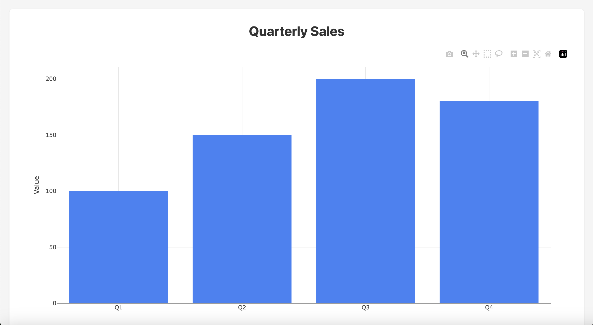
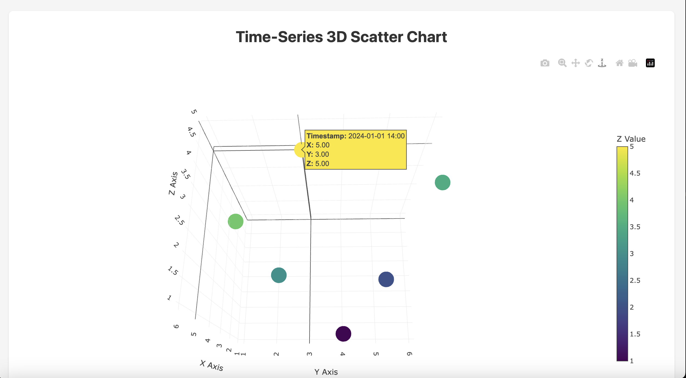

# Miniplot

Interactive chart visualization extension for DuckDB - faster than pandas with Plotly-like interactive charts, all from SQL.

## 🎯 Mission

**"One tool. One query. Instant visualization."**

Replace multiple libraries (pandas, matplotlib, seaborn, plotly) with a single tool. No more context switching, no more complex workflows.

- 📊 **Multiple chart types**: Bar, Line, Scatter, Area, Histogram, Box, and 3D Scatter charts
- 🌐 **Browser-based rendering**: Charts open in your default web browser
- 🔌 **Internet required**: Initial chart rendering requires connection (Plotly.js CDN)

## ✨ What's New in v0.0.3

- 3D Scatter Charts - Visualize three-dimensional data with interactive 3D scatter plots
- Timestamp Support - Add temporal dimension to 3D visualizations
- File Output Control - Save charts to custom paths or `/tmp/` directory
- Full Unicode Support - Complete support for Japanese and other non-ASCII characters
- Flexible Output Options - Browser (default), `/tmp/`, or custom path
- CSV Integration - Seamless data visualization from CSV files
- Batch Processing - Generate multiple charts and export paths with `COPY TO`

## Installation

```sql
INSTALL miniplot FROM community;
LOAD miniplot;
```

That's it! No additional setup required.

## 🚀 Easiest Example - 30 Seconds to Your First Chart

**Step 1: Create `test.csv` in your local directory**

```csv
product,revenue
iPhone,450
MacBook,380
iPad,290
AirPods,185
Watch,160
```

**Step 2: Open DuckDB CLI**

```bash
duckdb
```

**Step 3: Install and load miniplot**

```sql
INSTALL miniplot FROM community;
LOAD miniplot;
```

**Step 4: Visualize!**

```sql
SELECT bar_chart(
    list(product),
    list(revenue),
    'Product Revenue'
) FROM 'test.csv';
```

**Result:** Interactive chart opens in your browser instantly! 🎉

---

## Examples

### Bar Chart



### 3D Scatter Chart



## Usage Examples

### Additional chart APIs (source builds)

The following additions require an extension built from this repository; an older
community-distributed binary may not contain them yet. Each accepts a title after
the data arguments, plus an optional output path (`'tmp'`, a custom HTML path, or
an empty path to open a browser). Each also has a pure `*_chart_html` variant.

| Function | Data arguments | Use |
|---|---|---|
| `pie_chart` | labels, values | Shares; values must be nonnegative with at least one positive value |
| `donut_chart` | labels, values | Shares with a central hole |
| `horizontal_bar_chart` | labels, values | Long category labels |
| `violin_chart` | samples | Distribution shape from raw observations |
| `bubble_chart` | x, y, sizes | Three numeric variables; sizes are nonnegative pixel diameters |
| `heatmap_chart` | x, y, z | Matrix/grid values |
| `contour_chart` | x, y, z | Contour levels on a grid |
| `step_chart` | x, y | Horizontal-then-vertical steps; input order is preserved |
| `radar_chart` | labels, values | Nonnegative values on labeled radial axes |
| `scatter_gl_chart` | x, y | Large point sets using WebGL |

```sql
SELECT pie_chart_html(['A','B'], [1.0,2.0], 'Shares');
SELECT donut_chart_html(['A','B'], [1.0,2.0], 'Shares');
SELECT horizontal_bar_chart_html(['Long category A','Long category B'], [1.0,2.0], 'Categories');
SELECT violin_chart_html([1.0,2.0,2.0,4.0], 'Distribution');
SELECT bubble_chart_html([1.0,2.0], [3.0,4.0], [10.0,20.0], 'Bubbles');
SELECT heatmap_chart_html([1.0,2.0], [3.0,4.0], [[5.0,6.0],[7.0,8.0]], 'Heatmap');
SELECT contour_chart_html([1.0,2.0], [3.0,4.0], [[5.0,6.0],[7.0,8.0]], 'Contour');
SELECT step_chart_html([1.0,2.0,10.0], [3.0,4.0,5.0], 'Steps');
SELECT radar_chart_html(['Speed','Quality','Cost'], [8.0,7.0,5.0], 'Scores');
SELECT scatter_gl_chart_html([1.0,2.0], [3.0,4.0], 'WebGL scatter');
```

Numeric inputs are DOUBLE arrays. Arrays must be nonempty, equally sized where
paired, finite and free of NULL elements. Grid x/y axes must be strictly increasing;
`z` has `len(y)` rows and `len(x)` columns. SQL NULL arguments return NULL.
The WebGL variant requires working WebGL; it does not silently sample points or
fall back to SVG. Browser/GPU memory still limits practical data size. Filter or
aggregate in SQL when displaying every observation is unnecessary.

### Narrative HTML reports for agents

`chart_report_html(report_json)` returns a complete document containing prose and
multiple charts. `chart_report(report_json, output_path)` saves it as HTML.
The input is a JSON object with a string `title` and a nonempty `sections` array.
Each section accepts `heading`, `text`, and optional Plotly `data`, `layout` and
`config`. A section needs a nonempty heading/text or chart data. The
[JSON schema](docs/report.schema.json) describes the contract.

```sql
SELECT chart_report_html(to_json({
    'title': 'Sales analysis',
    'sections': [{
        'heading': 'Findings',
        'text': E'B sold twice as much as A.\nValues are raw observations.',
        'data': [{'type': 'bar', 'x': ['A','B'], 'y': [1,2]}],
        'layout': {'title': {'text': 'Sales'}}
    }]
}));
```

Headings and prose are plain text, with HTML characters escaped and line breaks
preserved; raw HTML/Markdown is not interpreted. Invalid ASCII controls are
replaced in HTML text. JSON plot data keeps its original values. Reports embed
an exact, non-executable JSON specification in
`<script type="application/json" id="miniplot-report">`, so agents can recover
and reproduce the original report without scraping its visual layout. Script
terminators in that JSON are escaped. Charts render responsively and sections
are kept together when printing where page size permits.

Agents can discover argument names, types, descriptions, examples, categories and
side effects through the existing `duckdb_functions()` catalog rather than guess
SQL signatures. All new overloads include runnable examples. HTML functions are
pure and support `TRY(...)`; functions that write files or launch a browser are
marked as having side effects. All file/browser/export APIs respect
`enable_external_access=false`; HTML return functions remain available.

### PNG and PDF output directly from SQL (optional native tool)

`chart_export(html, output_path)` renders current Miniplot HTML to `.png` or `.pdf`
and returns the path. It supports ordinary charts and narrative reports. This
optional feature needs Node.js 18+, the local tool dependencies, and Chromium:

```sh
# In this repository, on the same machine that runs DuckDB:
npm ci
npx playwright install chromium
export MINIPLOT_EXPORTER="$PWD/scripts/export-chart.cjs"
# Start DuckDB from this environment, then load your built extension.
```

```sql
SELECT chart_export(bar_chart_html(['A','B'], [1.0,2.0], 'Sales'), 'sales.png');
SELECT chart_export(chart_report_html(
    '{"title":"Summary","sections":[{"text":"Sales increased.","data":[{"type":"bar","x":["A","B"],"y":[1,2]}]}]}'
), 'report.pdf');
```

Exports use the pinned local Plotly.js bundle and block network requests, so no
CDN connection is needed after tool/browser installation. PNG captures the full
page at a 1200-pixel viewport; PDF prints A4 pages with Japanese/selectable text
where fonts are available. Rendering waits for Plotly promises and fonts. A failed
render preserves an existing destination file and cleans temporary files. Export
is synchronous and starts a browser per call; it is intended for artifacts, not
high-throughput per-row rendering. Server containers need Chromium system
libraries (`npx playwright install --with-deps chromium`). Wasm cannot spawn a
local browser; use HTML output there. Native export is locally verified on macOS
arm64 and included in Linux CI; other hosts need their own validation.

### Large-data performance and validation

Numeric serialization now reuses one locale-aware stream per array rather than
constructing a stream for each value. DOUBLE round-trip precision is retained.
The regression suite executes one million WebGL points and checks lengths and
sample coordinates at the JavaScript boundary; it never drops observations.

Reproduce SQL serialization measurements (including CLI startup and aggregation):

```sh
python3 test/benchmark.py --duckdb /path/to/duckdb --extension /path/to/miniplot.duckdb_extension --output benchmark.json --repeats 5
node test/render_benchmark.cjs /path/to/duckdb /path/to/miniplot.duckdb_extension
```

[Measured results and methodology](docs/performance-20261031.md) separate SQL/HTML
serialization from actual Chromium/WebGL PNG rendering. Timings depend on data,
hardware, browser/GPU and load; they are not a guarantee for arbitrary datasets.
Generated documents are parsed for HTML errors, scripts are executed with hostile
strings, all ten added charts are rendered in real Chromium, and SQL-created
PNG/PDF files are checked for content, dimensions and page count. This validates
our generated documents and documented contracts; arbitrary options passed through
`plotly_new` still follow Plotly's own schema and rendering limits.


### Custom Plotly JSON (#3)

`plotly_new(data, layout [, config [, output_path]])` passes a JSON array of trace
objects and JSON layout/config objects to `Plotly.newPlot`. Omitted `config`
defaults to `{}`. Use `'tmp'` or a custom output path to save without opening the
browser; omitting the path opens the generated file. The return value is the
file path. `plotly_new_html(data, layout [, config])` returns the HTML document
without writing a file or opening a browser.

```sql
SELECT plotly_new(
    '[{"x":[1,2,3],"y":[3,1,4],"type":"scatter","name":"Observed"},
      {"x":[1,2,3],"y":[2,2,3],"type":"scatter","name":"Expected"}]',
    '{"title":{"text":"Comparison"},"xaxis":{"title":"Day"},"showlegend":true}',
    '{"responsive":true,"displayModeBar":false}',
    'tmp'
);

-- Build JSON from DuckDB lists and structs instead of assembling JSON strings.
SELECT plotly_new_html(
    to_json([{'x': [1,2], 'y': [3,4], 'type': 'bar', 'name': 'Sales'}]),
    to_json({'title': {'text': 'Sales'}, 'showlegend': true})
);
```

Strings containing malformed JSON, non-object traces, or non-object layout/config
are rejected by SQL. SQL `NULL` arguments return `NULL`. Plotly handles the
individual trace/layout options; this extension validates the JSON and its top
level shapes, not every Plotly option. Strings are escaped before embedding in
HTML, including `</script>` text. Rendering uses the existing Plotly.js 2.27.0 CDN.

### Dates and timestamps on 2D scatter axes (#4)

Both `scatter_chart` and `scatter_chart_html` accept `DOUBLE[]`, `DATE[]`,
`TIMESTAMP[]`, or `TIMESTAMPTZ[]` on either axis, including two date/time axes.
Numeric axes remain numeric; date/time axes explicitly use Plotly's date scale.

```sql
SELECT scatter_chart(
    [TIMESTAMP '2026-01-01 09:00:00', TIMESTAMP '2026-01-01 10:30:00'],
    [12.5, 15.0],
    'Sensor readings',
    'tmp'
);

SELECT scatter_chart_html([1.0, 2.0], [DATE '2026-01-01', DATE '2026-01-03'], 'Dates');
```

`TIMESTAMP` preserves wall-clock fields; `TIMESTAMPTZ` instants are displayed in
UTC, independent of the DuckDB session time zone. Cast timestamp precision
variants explicitly to `TIMESTAMP[]` when needed. Plotly's date display precision
is separate from DuckDB's timestamp precision. Arrays must be nonempty, have
matching lengths, and contain no NULL or infinite values; SQL NULL arguments
return NULL.

### Numeric and time axes for line and area charts

`line_chart`, `area_chart`, and their `*_html` variants also accept `DOUBLE[]`,
`DATE[]`, `TIMESTAMP[]`, or `TIMESTAMPTZ[]` for x, with `DOUBLE[]` for y.
Numeric x values use a linear scale, so uneven sampling intervals retain their
spacing. Time axes use a date scale. Existing `VARCHAR[]` labels remain supported.

```sql
-- The interval from 2 to 10 is eight times the interval from 1 to 2.
SELECT line_chart([1.0, 2.0, 10.0], [0.1, 0.2, 0.3], 'Uneven samples', 'tmp');

SELECT area_chart_html(
    [TIMESTAMP '2026-01-01 10:00:00.123456', TIMESTAMP '2026-01-01 12:00:00'],
    [12.5, 15.0], 'Sensor readings'
);
```

Like scatter charts, these axes serialize finite doubles with round-trip precision;
`TIMESTAMP` retains wall-clock fields and `TIMESTAMPTZ` is converted to UTC.
Input order is preserved; sort aggregated lists explicitly when needed. Arrays
must be nonempty, equally sized and contain no NULL or infinite values. SQL NULL
arguments return NULL. File, browser and HTML output modes work as before.

Numeric axes use IEEE 754 doubles: integers beyond 2^53 and high-precision DECIMAL
values can lose precision when converted to DOUBLE. Timestamp text retains DuckDB's
microseconds, while Plotly/browser date rendering has its own precision limits.

### Discover functions through SQL (#5)

Every overload, including HTML variants and the diagnostic functions, provides
real argument names, a description, a runnable example and a `visualization`
category through DuckDB's function catalog:

```sql
SELECT function_name, parameters, parameter_types, description, examples
FROM duckdb_functions()
WHERE function_name IN ('plotly_new', 'plotly_new_html', 'scatter_chart', 'scatter_chart_html');
```

Functions that write files or launch a browser are marked as having side effects.
The `*_html` functions are pure and support `TRY(...)` for invalid row inputs.

### Distribution charts: histograms and box plots

Use `histogram_chart(samples, title [, output_path])` for a frequency distribution
or `box_chart(samples, title [, output_path])` for a box-and-whisker plot.
`histogram_chart_html(samples, title)` and `box_chart_html(samples, title)` return
HTML without file or browser side effects.

```sql
SELECT histogram_chart([1.0, 2.0, 2.0, 3.0, 8.0], 'Frequency', 'tmp');
SELECT box_chart_html([1.0, 2.0, 2.0, 3.0, 8.0], 'Spread');

-- Aggregate raw observations, retaining duplicates.
SELECT histogram_chart(list(amount), 'Sales distribution', 'tmp') FROM sales;
```

These functions preserve every sample, including duplicates, using round-trip
DOUBLE serialization. Plotly chooses histogram bins and computes box-plot
quartiles and outliers in the browser. For explicit bins or a different quartile
method, use `plotly_new` with custom trace options. These are visualizations of
raw samples; they do not return a table of statistical results.

Samples must be a nonempty numeric array with finite, non-NULL elements.
SQL NULL arguments return NULL; invalid inputs to HTML variants support `TRY`.
The same DOUBLE precision and CDN requirements as other charts apply.

### Basic Charts

#### Bar Chart

```sql
SELECT bar_chart(
    ['Q1', 'Q2', 'Q3', 'Q4'],
    [100.0, 150.0, 200.0, 180.0],
    'Quarterly Sales'
);
```

#### Line Chart

```sql
SELECT line_chart(
    ['Jan', 'Feb', 'Mar', 'Apr', 'May'],
    [5.2, 7.1, 12.5, 15.8, 20.3],
    'Monthly Temperature'
);
```

#### Scatter Chart

```sql
SELECT scatter_chart(
    [1.0, 2.0, 3.0, 4.0, 5.0],
    [2.5, 5.0, 7.5, 10.0, 12.5],
    'Correlation Analysis'
);
```

#### Area Chart

```sql
SELECT area_chart(
    ['Week1', 'Week2', 'Week3', 'Week4'],
    [1000.0, 1500.0, 1300.0, 1800.0],
    'Weekly Revenue'
);
```

### 3D Scatter Charts (New in v0.0.3)

#### Basic 3D Scatter

```sql
-- Opens in browser
SELECT scatter_3d_chart(
    [1.0, 2.0, 3.0, 4.0, 5.0, 6.0],
    [2.0, 4.0, 1.0, 5.0, 3.0, 6.0],
    [3.0, 1.0, 4.0, 2.0, 5.0, 3.5],
    '3D Data Visualization'
);
```

#### 3D Scatter with Timestamps

```sql
-- Add temporal dimension
SELECT scatter_3d_chart(
    [1.0, 2.0, 3.0, 4.0, 5.0, 6.0],
    [2.0, 4.0, 1.0, 5.0, 3.0, 6.0],
    [3.0, 1.0, 4.0, 2.0, 5.0, 3.5],
    ['2024-01-01 10:00', '2024-01-01 11:00', '2024-01-01 12:00',
     '2024-01-01 13:00', '2024-01-01 14:00', '2024-01-01 15:00'],
    'Time-Series 3D Scatter'
);
```

### Output Control (New in v0.0.3)

```sql
-- Save to /tmp/ without opening browser
SELECT bar_chart(
    ['A', 'B', 'C'],
    [10.0, 20.0, 15.0],
    'Sample Chart',
    'tmp'
);

-- Save to custom path
SELECT line_chart(
    ['Q1', 'Q2', 'Q3', 'Q4'],
    [250.0, 320.0, 410.0, 380.0],
    'Quarterly Report',
    'reports/q4_sales.html'
);

-- Save 3D chart to specific location
SELECT scatter_3d_chart(
    [10.0, 20.0, 30.0, 40.0],
    [15.0, 25.0, 20.0, 35.0],
    [5.0, 10.0, 8.0, 12.0],
    ['09:00', '12:00', '15:00', '18:00'],
    'Sensor Data',
    'data/sensor_3d.html'
);
```

### Unicode Support (New in v0.0.3)

```sql
-- Japanese titles and labels
SELECT bar_chart(
    ['春', '夏', '秋', '冬'],
    [15.0, 28.0, 18.0, 5.0],
    '季節別平均気温（℃）'
);

-- Japanese data with timestamps
SELECT scatter_3d_chart(
    [10.0, 20.0, 30.0],
    [15.0, 25.0, 20.0],
    [5.0, 10.0, 8.0],
    ['午前', '正午', '午後'],
    '温度センサー',
    'temp_sensor.html'
);
```

### Working with Tables

```sql
-- Create sample data
CREATE TABLE sales AS
SELECT 'Mon' as day, 100.0 as amount UNION ALL
SELECT 'Tue', 150.0 UNION ALL
SELECT 'Wed', 120.0 UNION ALL
SELECT 'Thu', 180.0 UNION ALL
SELECT 'Fri', 140.0;

-- Visualize directly from table
SELECT bar_chart(
    list(day ORDER BY day),
    list(amount ORDER BY day),
    'Weekly Sales Report'
) FROM sales;
```

### Working with CSV Files

```sql
-- Load CSV data
CREATE TABLE stocks AS
SELECT * FROM read_csv_auto('stocks.csv');

-- Visualize stock prices
SELECT line_chart(
    list(CAST(date AS VARCHAR) ORDER BY date),
    list(price ORDER BY date),
    'Stock Price Trend'
)
FROM stocks;

-- Direct CSV visualization
SELECT bar_chart(
    list(month),
    list(sales),
    'Monthly Sales from CSV',
    'output.html'
) FROM read_csv('sales.csv');
```

### Advanced CSV Processing

```sql
-- Filter and visualize
SELECT line_chart(
    list(date ORDER BY date),
    list(temperature ORDER BY date),
    '2024 Temperature Trend',
    'temp_2024.html'
) FROM read_csv('weather.csv')
WHERE date >= '2024-01-01' AND date < '2025-01-01';

-- Aggregate and visualize top 10
SELECT bar_chart(
    list(customer_name ORDER BY total_sales DESC),
    list(total_sales ORDER BY total_sales DESC),
    'Top 10 Customers',
    'top_customers.html'
) FROM (
    SELECT customer_name, sum(sales) AS total_sales
    FROM read_csv('customer_sales.csv')
    GROUP BY customer_name
    ORDER BY total_sales DESC
    LIMIT 10
);
```

### Batch Chart Generation with COPY TO

```sql
-- Generate single chart and save path
COPY (
    SELECT
        'bar_chart' AS chart_type,
        bar_chart(
            ['A', 'B', 'C'],
            [10.0, 20.0, 15.0],
            'Sample Chart',
            'output_bar.html'
        ) AS file_path
) TO 'chart_paths.csv' (HEADER, DELIMITER ',');

-- Generate multiple charts and export paths
COPY (
    SELECT 'bar_chart' AS type,
           bar_chart(['A','B','C'], [10,20,15], 'Bar', 'bar.html') AS path
    UNION ALL
    SELECT 'line_chart' AS type,
           line_chart(['X','Y','Z'], [5,10,8], 'Line', 'line.html') AS path
    UNION ALL
    SELECT 'scatter_chart' AS type,
           scatter_chart([1,2,3], [2,4,3], 'Scatter', 'scatter.html') AS path
) TO 'all_charts.csv' (HEADER);
```

## Requirements

- **Internet connection**: Required for first-time chart rendering (Plotly.js loads from CDN)
- **Browser**: Any modern web browser (Chrome, Firefox, Safari, Edge)
- Regular HTML can reuse a cached Plotly.js bundle, but caching is not guaranteed; native PNG/PDF export uses the installed local bundle.

## License

MIT License - see [LICENSE](LICENSE) file

## Acknowledgments

- Built with [DuckDB](https://duckdb.org/)
- Powered by [Plotly.js](https://plotly.com/javascript/)
- Written in C++

## Links

- [Community Extensions](https://github.com/duckdb/community-extensions)
- [Issue Tracker](https://github.com/nkwork9999/miniplot/issues)
- [DuckDB Documentation](https://duckdb.org/docs/)
